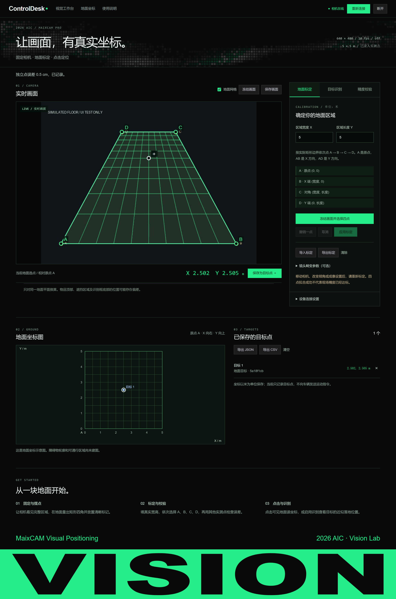

# MaixCAM Pro · 地面视觉定位上位机

固定相机，把画面中的地面位置换算成实际二维坐标。默认区域 **5 m × 5 m**，宽高可调；以你选择的 A 点为原点，AB 为 X 方向、AD 为 Y 方向，单位为米。

本项目基于 [MacSwimmm/upper-computer-template](https://github.com/MacSwimmm/upper-computer-template) 的 ControlDesk 模板，保留黑绿主题、点阵背景和页底网格形变。所有视觉相关源码、设备程序、Windows 上位机、检查工具和说明都集中在本目录。



## 直接使用

1. 用 USB 数据线连接 MaixCAM Pro。
2. 双击本目录的 **`启动视觉上位机.cmd`**，或直接运行 **`MaixVisionConsole.exe`**。已打包版不需要安装 Python。
3. 浏览器打开 `http://127.0.0.1:29860`，点击右上角 **连接相机**。程序自动查找 USB 地址、部署设备端程序并开始显示真实画面。若自动查找失败，在「设备连接设置」中填写相机地址；出厂用户名、密码均为 `root`，修改过密码时填写你自己的密码。
4. 使用完毕点击 **断开**，相机返回原应用菜单。关闭上位机窗口会停止电脑端服务；如果先关闭了服务，再次启动并连接即可接管原取图程序。

设备端程序位于 `/root/aic_vision/vision_agent.py`。本项目不会设置新的开机自启应用，也不向底盘发送运动指令。

## 地面标定

1. 固定相机的位置和倾角，让整块区域可见。在地面实际量出矩形边界，并在四个角放清晰标记。摆放物品可以保留，但尽量让四个角点和校验点可见。
2. 填写**实际宽度 X、实际长度 Y**。默认均为 5 米；填写的尺寸决定坐标尺度，不能靠改数字来扩大实际视野。
3. 点击「冻结画面并选择四点」，沿矩形边界依次点击：

   | 标记 | 实际坐标 |
   |---|---|
   | A，原点 | `(0, 0)` |
   | B，X 端 | `(宽度, 0)` |
   | C，对角 | `(宽度, 长度)` |
   | D，Y 端 | `(0, 长度)` |

4. 点击「应用标定」。画面叠加每 0.5 米的地面网格，并显示地面坐标图。相机的高度、倾角不需要另外精确测量。
5. 在近处、远处、边缘和中间另外量几个点，点击它们，在「精度校验」中填实测坐标并记录。系统显示这些点的均方根误差和最大误差；**四个角点拟合成功不能证明现场精度**。

标定和目标点会自动保存在本地 `data/`。也可以导出标定 JSON，在同一相机、同一成像设置下导入。相机移动、倾角变化、镜头或成像设置变化后，要重新标定。换区域尺寸或边界也需要重新选择相应角点；重新标定会清空旧坐标系下的目标点。

## 点击取坐标与目标点

- 在实时画面中点击**可见地面**，下方显示 `X、Y`，单位为米。
- 点击「保存为目标点」，将位置记录到地面坐标图；也可以直接点击坐标图选取区域内位置。
- 支持删除单点、清空目标点，导出 JSON / CSV。导出的坐标系名为 `ground`，不代表已经与后续导航地图对齐。
- 目标点仅保存，不会触发底盘运动。

## 自动识别

| 方式 | 输出点 | 使用条件 |
|---|---|---|
| YOLO11 | 识别框底边中心，**近似落地位置** | 预置 80 类常见物品模型；自制小车等目标可能要单独训练 |
| 红色标记 | 色块中心 | 红色标记需要实际贴在地面；当前为固定 LAB 阈值，现场光照下需要验证 |
| AprilTag | 标签中心 | 标签需要贴地；为适应该固件工作内存，使用 160×120 图像识别后换回 640×480 坐标 |

所有方式共用同一套地面标定。识别图像的缩放结果会先换回完整画面的像素坐标，再进行米制坐标换算。每张 JPEG 与它自己的识别结果、帧序号成对传输，画面中的识别框使用同帧数据。

进入或退出 YOLO 时，设备端取图程序会短暂重启，按官方例程的顺序先加载模型、再打开相机，以适应该设备的本地资源初始化要求。等待实时画面恢复后继续操作，640×480 成像约定不变；纯标记模式之间直接切换。

人物识别框底部、脚点或车辆可见接地点都可能受遮挡影响。物品顶部、悬空标签中心以及球心不能直接当作地面位置。物体遮挡后方地面时，相机也不能直接看穿它。本版没有障碍物轮廓建图、完整可通行区域判断或自动避障。

## 镜头畸变

四点单应性模型针对同一平面上的透视关系，不能自行消除镜头弯曲畸变。镜头畸变明显或需要更高精度时，可以导入与实际镜头和 **640×480 成像设置**匹配的 Brown-Conrady 参数，再重新选点标定。

参数 JSON 字段：`model: "brown"`、`image_size: [640,480]`、`fx`、`fy`、`cx`、`cy`、`dist: [k1,k2,p1,p2,k3]`。畸变参数也支持 4 项，省略 `k3`。这些数值必须来自该相机的实际镜头标定，不能使用随意估计的数值。鱼眼模型参数不能直接导入。

## 源码运行、检查与打包

Windows 中打开本目录，在资源管理器地址栏输入 `pwsh` 后回车，再运行：

```powershell
python -m pip install -r requirements.txt
python host/server.py
```

可用参数：`--port 29860`、`--no-browser`、`--data-dir <目录>`。重复启动同一上位机会打开已有服务。

```powershell
python -m unittest discover -s tests -v
python -m pip install -r requirements-dev.txt
python tests/browser_check.py
pwsh -NoProfile -File tools/build.ps1
```

浏览器检查使用安装在默认位置的 Microsoft Edge，使用独立临时数据目录和模拟图片，不连接实机，不修改你的现场标定。截图里的坐标与校验误差都是软件功能示意。

## 设备运行库修复记录

这台设备最初能登录，但相机初始化和 YOLO 加载均在本地库中崩溃。2026-11-11 通过设备自带的 Sipeed 设置程序，从官方服务重新安装对应的 **1.22.0 运行库**后，取图和 YOLO11 推理恢复。

原运行库及版本文件备份在设备 `/root/aic_vision/runtime-backup/`。本次没有刷写系统镜像。临时网络设置已经恢复，原有应用源码、模型和自启配置未修改。设备绑定的运行库不随公共仓库发布。

后续连续检查还发现：在同一个进程中，普通取图后直接加载 YOLO 会导致这台设备失联。改为切换时重启取图进程、先模型后相机后，四种模式及返回普通取图的实机检查通过。灰色屏幕不等于相机损坏：本应用将图像传给电脑，没有在设备屏幕上绘制预览；正常断开后恢复设备菜单。

`tools/provision_runtime.py` 保留了本次官方安装流程，供相同故障诊断时使用；正常使用不需要运行它。它通过电脑为设备临时转接官方 HTTPS 服务，保留设备自身的 TLS 会话，调用原厂安装程序，并恢复临时网络设置。

## 文件与验证范围

```text
MaixCAM_Visual_Positioning/
├─ MaixVisionConsole.exe           Windows 可直接运行的上位机
├─ 启动视觉上位机.cmd
├─ host/                          本地服务、地面坐标计算、模板网页
├─ device/vision_agent.py          相机取图与识别程序
├─ tools/                         打包、官方运行库修复工具
├─ tests/                         几何、接口、浏览器检查
├─ docs/                          接口、验证记录与模拟截图
└─ data/                          本地连接和现场标定数据（不提交）
```

具体检查结果见 [验证记录](docs/VALIDATION.md)，后续集成见 [坐标与接口](docs/API.md)，模板来源见 [模板使用记录](docs/TEMPLATE.md)。现场画面、连接令牌、SSH 主机记录和实际标定文件保留在本地，不随公共 Git 仓库发布。

参考：[OpenCV 单应性教程](https://github.com/opencv/opencv/blob/4.x/doc/tutorials/features2d/homography/homography.markdown)、[MaixPy OpenCV](https://wiki.sipeed.com/maixpy/doc/zh/vision/opencv.html)、[MaixPy YOLO](https://wiki.sipeed.com/maixpy/doc/zh/vision/yolov5.html)、[MaixPy 官方运行库安装示例](https://github.com/sipeed/MaixPy/blob/v4.10.3/examples/tools/install_runtime.py)。
