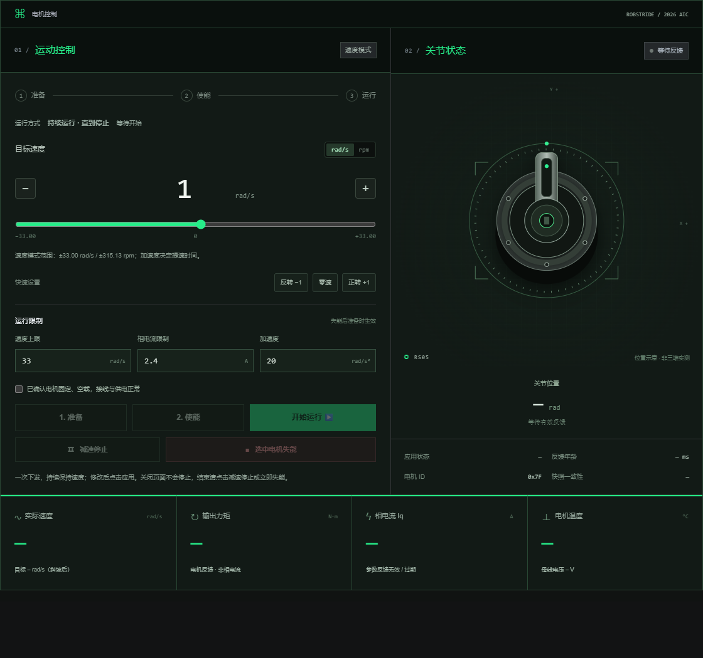

# 2026 AIC · RobStride05

## 小车 WASD 模式（2026-11-02）

上位机“电机控制”模块新增可展开的“小车 WASD · 两轮差速模式”。先下载本次配套 H7 固件，沿用原 SWD 调试连接，分别准备、使能两台电机后，在零速时进入键盘控制。W/S 前进后退，A/D 原地左右转，组合键转弯；松键按原加速度归零。可配置左轮电机和两轮前进方向。沿用现有 ±33 rad/s 范围与各电机已准备的速度上限，没有增加速度限幅。

单电机控制、ID 核对、曲线/CSV、诊断、OLED、灯带和外观设置保留。新增模式与独立运动命令互斥；Esc 继续两台全部失能。EXE、AXF/HEX 和内置固件档案已同步更新。本轮完成软件回归与 Keil 0 错误/0 警告编译，未烧录或实车试跑。操作和验证说明见 [WASD 使用说明](Docs/WASD.md)。

保留 [RobStride05](https://github.com/MacSwimmm/RobStride05) 完整工程，按 [upper-computer-template](https://github.com/MacSwimmm/upper-computer-template) 重构上位机视觉与交互。独立公开仓库，保留原项目历史；原仓库不受影响。


## 模板新增视效同步（2026-11-01）

同步模板 `71f6c07` 的黑绿功能区主题、标题/读数/诊断/曲线/日志悬浮网格撕裂、页底 RobStride 大字震颤，以及 OffscreenCanvas 后台点阵与兼容回退。两个悬浮效果可在“控制台设置”独立开关并保存，恢复默认外观时一并重置。触摸和系统减少动态效果模式保持静态；输入、点击和键盘焦点操作恢复原生控件。实时曲线和读数继续更新，失能及错误提示保留原语义颜色。

源码和单文件 EXE 同步更新；验证方法、截图与本轮范围见 [新增视效移植与回归](Docs/UI_EFFECTS.md)。

## 本次 UI 重构（2026-11-01）

采用模板的黑绿配色、动态点阵、大标题、横向导航、居中卡片与两侧预览、方形切换按钮、滚动进度和右侧设置抽屉。支持键盘、触摸和窄屏；可保存强调色、布局、日志与点阵偏好。**上位机 EXE 已重新打包**，双击 `上位机/RobStrideConsole.exe` 即可使用。

原有双电机控制、ID 配置与核对、实时观测、CSV、诊断、全部失能、WS2812 七种灯效、自定义循环及本机方案均保留。五个模块可通过顶部导航、卡片标签或左右箭头访问；在卡片标题栏或说明处可触摸滑动。Esc 继续请求两台全部失能，打开设置时同样有效。

原仓库的全部固件文件、CubeMX/Keil 工程、AXF/HEX、历史记录与原有测试按字节保留。Python 控制队列、命令校验、SWD 读写及固件身份检查保留；HTTP 服务仅增加界面静态资源的固定路由。

本轮完成原有 28 项 Python 测试、双电机/OLED/灯带 C 主机检查，以及源码和独立 EXE 的浏览器回归。固件在独立副本中用 Keil 重新编译，0 错误、0 警告；交付仍保留原仓库 AXF/HEX，避免改变原固件匹配关系。**本轮未连接电机做运动或灯带实物复测**；下文实板记录属于原项目的历史验证。

详见 [UI 重构与验证记录](Docs/UI_REFACTOR.md)。



## 原项目说明

STM32H743IIT6（Rev.V）+ FreeRTOS + 两台 RobStride 05，共用 CAN 总线。配套中文上位机、OLED 状态显示和 16 颗 WS2812 灯效控制。

## 当前功能

- 两台电机分别准备、使能、正反转调速、减速停止和失能；可同时持续运行。原电机 CAN ID 127，新增电机 ID 126。
- 上位机显示每台速度、位置、力矩、温度、电流、电压、命令回执及诊断，提供曲线与 CSV 导出。当前控制模式为速度模式，位置/力矩是反馈。
- OLED 同时显示两台状态、目标/实际速度，并显示 RTOS 运行统计。
- WS2812 共 16 颗，7 种灯效，支持颜色、亮度、速度、自定义循环列表、排序与重复、关灯/恢复、浏览器保存/读取方案。循环在 MCU 内执行。
- CPU 480 MHz、AHB 240 MHz、APB 120 MHz，LDO/VOS0；CAN 仍为 1 Mbps，OLED/灯带/RTOS 时基已同步适配。遵循原工程约定，ICache 与 DCache 均关闭。

## 目录

| 路径 | 内容 |
|---|---|
| `RobStride05_H743/` | HAL + FreeRTOS 固件、CubeMX 配置、Keil 工程、测试工具与中文说明 |
| `RobStride05_H743/MDK-ARM/Objects/` | 本次实测固件 AXF / HEX；其它编译中间文件不入库 |
| `上位机/RobStrideConsole.exe` | 可直接双击的 Windows 单文件上位机 |
| `上位机/RobStride_Console/` | Python 服务、浏览器前端、测试与打包脚本 |

本仓库只包含 RTOS 工程与配套上位机。文档中旧版单电机、200 MHz 和 HAL 兄弟工程的记录保留用于追溯；当前行为以第 10–12 篇说明为准。

## 使用

1. 打开 [固件说明](RobStride05_H743/README.md) 和 [双电机接入说明](RobStride05_H743/Docs/10_双电机独立控制与实测.md)，核对接线与两台不同 CAN ID。若电机仍为相同出厂 ID，必须逐台隔离配置，不能同时修改。
2. 用 Keil 打开 `RobStride05_H743/MDK-ARM/RobStride05_H743.uvprojx`，编译并下载；配套 AXF/HEX 已随仓库提供。当前满频启动要求 H743 Rev.V 与匹配的供电条件。
3. 退出 Keil Debug，释放探针。双击 `上位机/RobStrideConsole.exe`，浏览器将打开 `http://127.0.0.1:8765`。
4. 选择探针连接，核对两台身份，再在每台卡片中依次准备 → 使能 → 运行。顶部“全部失能”或 Esc 同时请求两台失能。
5. 灯带控制无需使能电机。详见 [自定义灯效说明](RobStride05_H743/Docs/11_WS2812上位机自定义灯效.md)。

上位机通信路径是 **USB 调试探针 → SWD → H743 → CAN → 电机**，无需串口。连接时核对完整 Flash，自动从相邻 AXF 提取内存布局；单独移动 EXE 则使用打包时的内置固件档案。

运行命令持续有效。仅关闭页面不会停止电机；使用界面停止/失能/断开/退出。当前电机版本拒绝电机侧通信超时参数，因此 CAN 断线或 MCU 停机不能保证自动停机，使用时需保留直接切断电源的手段。

## 构建与验证

开发环境：Windows、PowerShell 7、Python 3.11+、Keil MDK ARMCC 5.06u7、STM32H7xx_DFP（本次为 2.7.0）。主机 C 检查另需 GCC；UI 自动化另需 Playwright 和 Edge；打包另需 PyInstaller。

```powershell
# 在仓库根目录执行
python -m pip install -r ./上位机/RobStride_Console/requirements.txt
pwsh -File ./RobStride05_H743/Tools/build.ps1
pwsh -File ./RobStride05_H743/Tools/test_host.ps1
Push-Location ./上位机/RobStride_Console
python -m unittest discover -s tests -v
# 如需重新打包：python -m pip install pyinstaller
pwsh -File ./build-singlefile.ps1
Pop-Location
```

`Tools/build.ps1` 默认 Keil 位于 `C:\Keil_v5\UV4\UV4.exe`；可用 `-Keil` 和 `-Python` 指定路径。CubeMX 再生成后应执行 `Tools/integrate.py`，恢复已验证的启动与 RTOS 集成；修改初始化时也要更新 `Tools/cubemx_baseline`。

本次已完成 0 错误/0 警告编译、实板烧写、满频寄存器与时间基准核对、双电机正反转和同时 ±5 rad/s、单台独立停止、OLED 帧缓冲回读、7 种灯效与自定义列表回归，以及并行运行检查。最终两台均已失能。没有进行负载、极限速度和长期温升测试；逐颗实际发光未做光学验收。

完整时钟表、测试证据与产物 SHA256 见 [480 MHz 性能配置与实板回归](RobStride05_H743/Docs/12_480MHz性能配置与实板回归.md)。

## 第三方代码

保留 STM32 HAL、CMSIS、FreeRTOS 等组件原有版权与许可证；相关声明见 [Docs/Licenses](RobStride05_H743/Docs/Licenses)。上位机依赖及其许可证随各自项目分发。仓库未对全部代码另行授予统一许可证。
